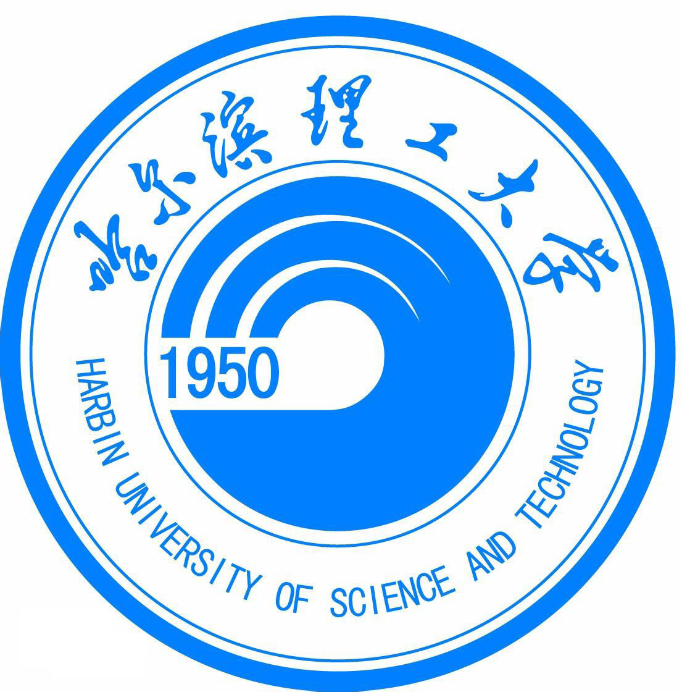

  

<h1 align="center">哈尔滨理工大学飞跃手册</h1>

保研 · 出国 · 就业

## 关于本手册

本项目受到[南方科技大学飞跃手册](https://sustech-application.com/)与[上海交通大学飞跃手册](https://survivesjtu.github.io/SJTU-Application/#/)的启发。感谢两校同学对经验分享与开源共建的投入，也希望将这份互助的善意延续到哈尔滨理工大学。

从大一开始，我得到了许多老师与学长学姐的帮助。在完成自己的保研申请后，我希望把准备过程中的经历、疑问与收获记录下来，为后来的学弟学妹提供一些参考。这也是《哈尔滨理工大学飞跃手册》的起点。

本手册希望逐步汇集哈理工同学在**保研、出国深造与交流、实习及就业**等方向的真实经历，整理前期准备、信息搜集、材料撰写、申请面试等环节的流程与时间线，帮助大家了解不同选择需要怎样的准备。

欢迎不同学院、专业和背景的同学参与补充。无论是顺利的经验、走过的弯路，还是作出选择时的思考，都可能给后来者带来帮助。希望这份手册能够随着一届届同学的分享不断完善，让我们曾经得到的帮助，继续传递下去。
- 📮 **投稿说明**：文件分类与上传方式可参考 [上海交通大学飞跃手册](https://github.com/SurviveSJTU/SJTU-Application) 和 [南方科技大学飞跃手册贡献指南](https://sustech-application.com/docs/contribute)。向本手册投稿时，请按「经验分享 → 院系 → 升学、出国、就业等分类」选择对应目录，欢迎通过 **Pull Request** 提交经验分享，审核后收录。
# 🌱 为什么我们需要一本飞跃手册（集市星辰炼金师留言）

如果这本手册能够被更多同学看见，帮助大家更早了解大学里的选择、机会与准备方法，我相信它会产生长远的价值。

一个同学少走一些弯路，可能就能获得更好的发展；更多同学成长起来，也有机会逐渐积累学校的口碑，吸引更多优秀的考生报考，再让新的经验不断传递下去。

这或许就是一个正向循环的起点。

---

## 很多同学，需要更早知道该怎样准备

我一直觉得，学校的录取分数和一个人当下的表现，很难完整定义他的学习能力与发展潜力。

有些同学并不缺少努力的意愿，却很晚才知道：

- 原来保研需要提前关注成绩、排名与相关规则；
- 原来竞赛可以从低年级开始了解和参与；
- 原来科研、实习与英语能力，可以逐步积累；
- 原来不同的升学和就业方向，需要不同的准备。

大一入学时，大家的状态可能相差不大。几年之后，在升学、就业和职业选择上，却可能走出很不一样的道路。

这些差异受到很多因素影响。其中，**能否及时获得信息、理解选择，并把努力投入到合适的方向上**，是我们可以尝试帮助彼此改善的一部分。

---

## 家庭已经尽力，成长中的信息仍需要有人补上

对于一些家庭来说，能够支持孩子读完大学，已经投入了很多心力。

父母或许非常关心孩子的未来，却不熟悉大学里的培养方式，也不了解保研、科研、竞赛、实习和招聘的具体流程，很难提供有针对性的建议。

学生进入大学后，就需要独自摸索这些事情。有时花了很多时间，才发现某个机会早已错过，某项准备本可以更早开始。

如果能够在大一时就有人告诉他们：

> 你有哪些选择，每条路大致需要什么准备，以及现在可以先做哪一步。

那么，大学四年或许就能多一些主动，少一些迷茫。

---

## 拿我自己来说：许多事情，我知道得太晚了

我来自一个小地方，高中也没有特别优越的教学条件。一路学习下来，最终进入了哈尔滨理工大学的工科专业。

我不觉得自己是一个学习能力很差的人，但进入大学后，我确实缺少规划，也不知道应该主动了解哪些事情。

直到大二，我才知道保研这条路；也是到了大二、大三，才逐渐了解原来还可以参加不同类型的比赛。

回头看，大学四年就在不断摸索中过去了。很多事情，等自己意识到值得准备时，已经比较晚了。

毕业后的工作也没有达到自己的预期。如今，我已经裸辞，正在脱产备考，希望能够进入一所更理想的学校继续学习。重新选择的过程中，压力确实很大。

所以，我尤其希望后来的同学，能够更早接触到这些信息。

**如果当年有人在我大一时，把这些选择和准备方法讲清楚，我或许会更有方向地度过大学四年。**

---

## 秋招，需要从投递之前就开始准备

求职也是如此。

理想的状态，是在秋招之前，就开始了解目标岗位的要求，并逐步积累相应的课程基础、项目经历、实践能力与表达能力。

投递和面试，也可以帮助我们发现不足，再继续调整准备。

扩大投递范围的同时，更值得关注的是：

- 自己希望从事什么工作；
- 目标岗位需要哪些能力；
- 自己有哪些经历能够证明这些能力；
- 当前还有哪些不足，可以尽早补上。

同一家公司，不同岗位的工作内容、培养方式、成长空间和职业发展路径，也可能存在很大差异。

因此，选择工作时，除了公司名称，也需要认真了解岗位本身，以及它与自己长期目标的关系。

---

## 希望这些经验，能更早抵达需要它的人

一本手册无法替所有人规划人生，但它可以把一些原本分散、难找的信息整理出来，让更多同学有机会提前了解、比较和准备。

我们可以把自己经历过的申请流程、踩过的坑、错过的机会，以及后来才明白的道理写下来。

也许其中某一段经历，就能让一个刚入学的同学意识到：

**原来还有这样的选择，原来我现在就可以开始准备。**

希望这本手册，能让更多同学知道力气可以往哪里使，让家庭已经尽力托举的孩子，在进入大学后，也能获得更多继续向前的支持。

## https://www.bilibili.com/video/BV1F3JZ6SEdb/?buvid=Y4437C42491F7F03420DA977223C8FB1C0EB&is_story_h5=false&mid=wy9qOszRtDNa3lgrxCI9Mw%3D%3D&plat_id=240&share_from=ugc&share_medium=iphone&share_plat=ios&share_source=WEIXIN&share_tag=s_i&timestamp=1792465690&unique_k=h90NXLD&up_id=431298736 
## 上述链接是理工一位十佳毕业生学长（获得浙大国奖）b站进行的一些电力电子相关知识分享，感兴趣的同学可以自行查阅~
